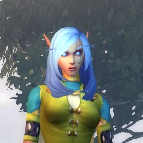
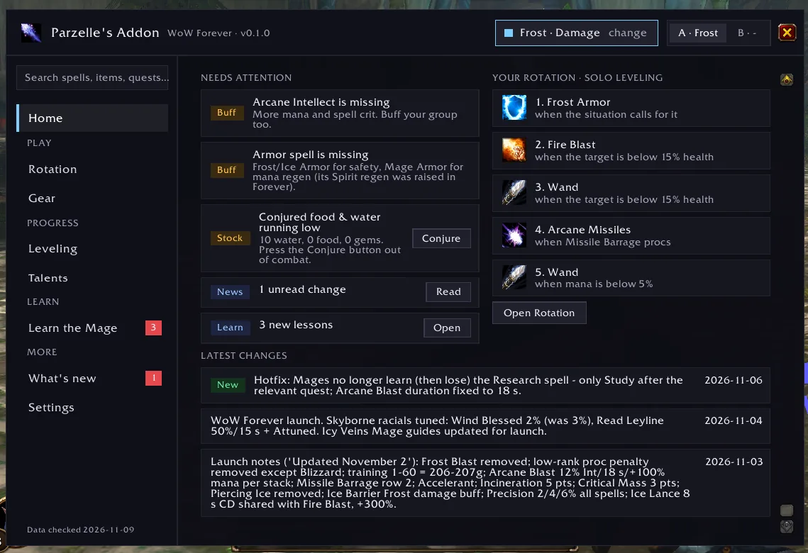
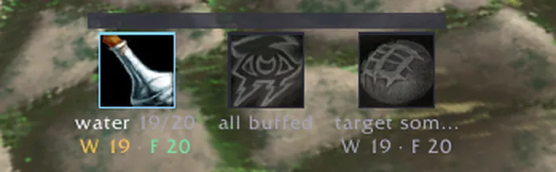
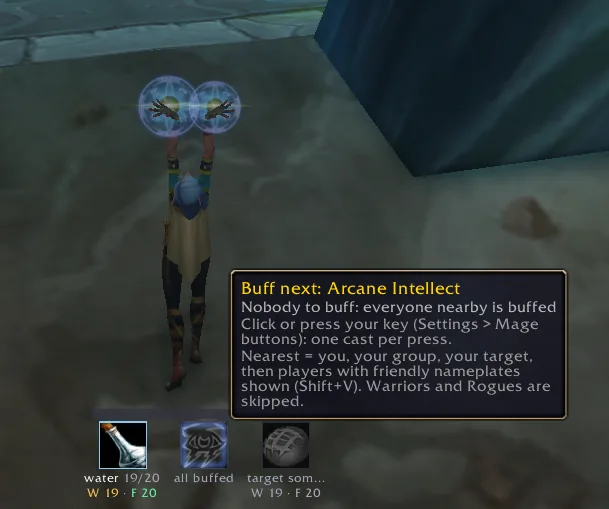
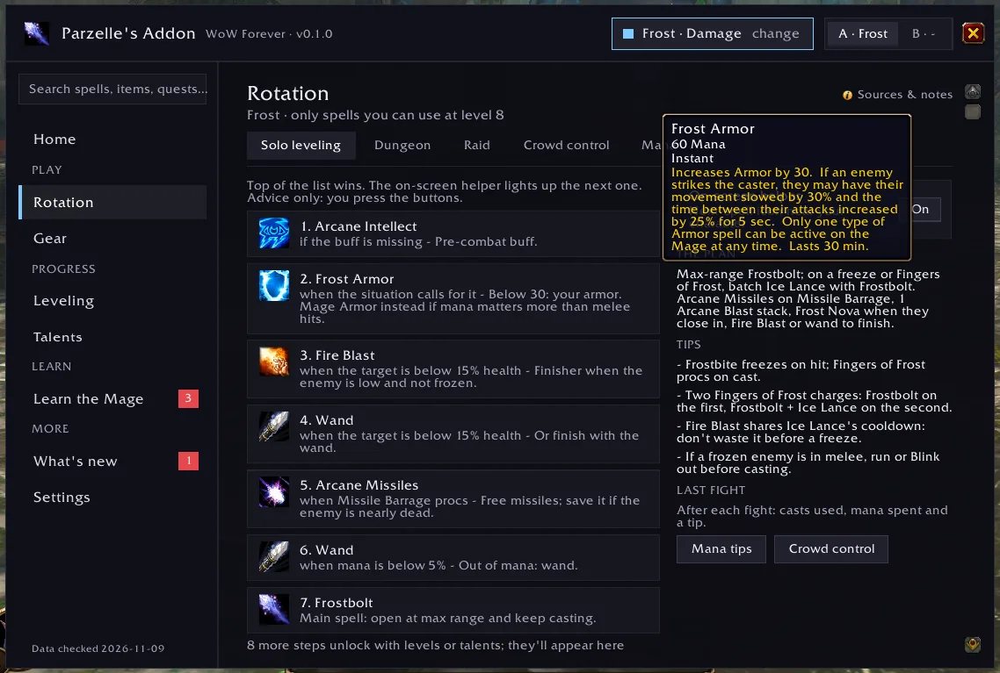
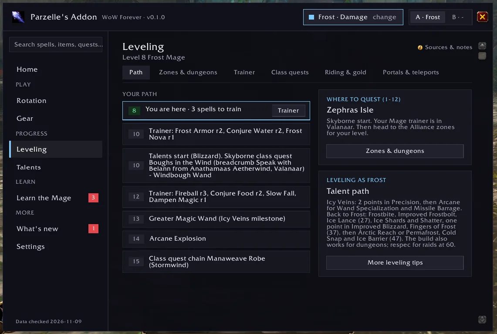
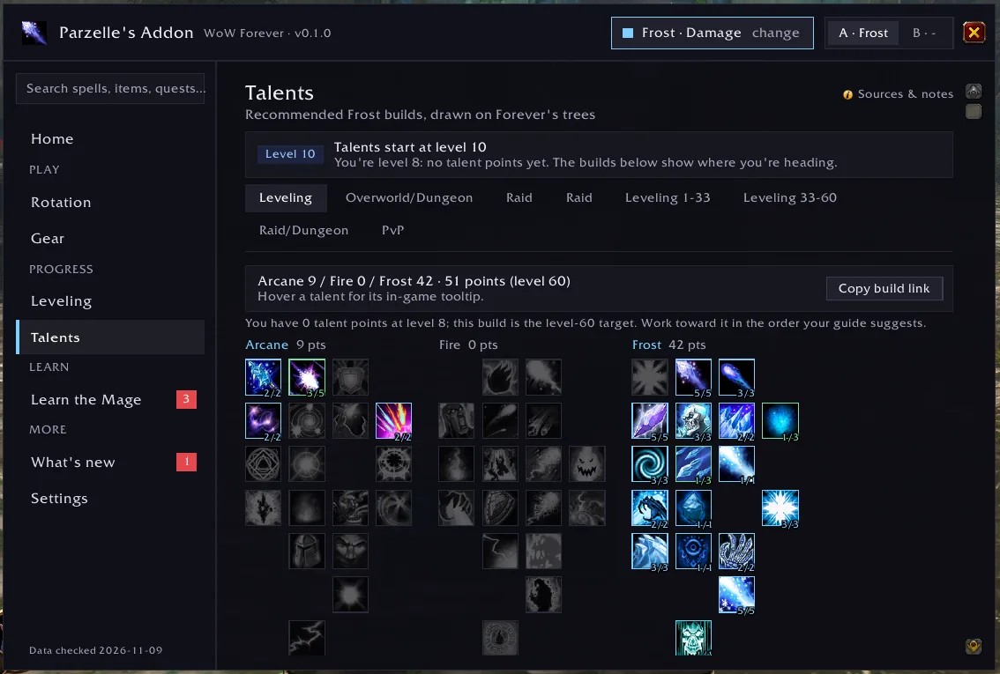
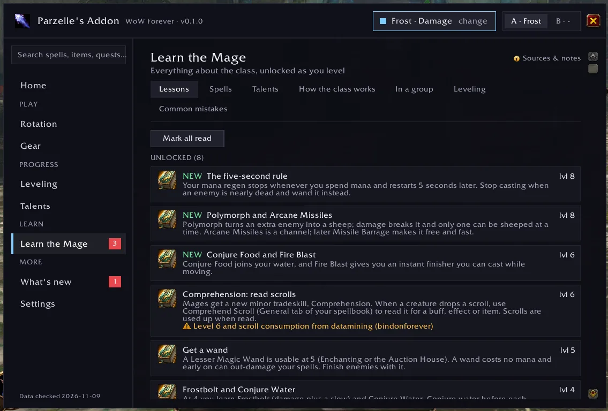
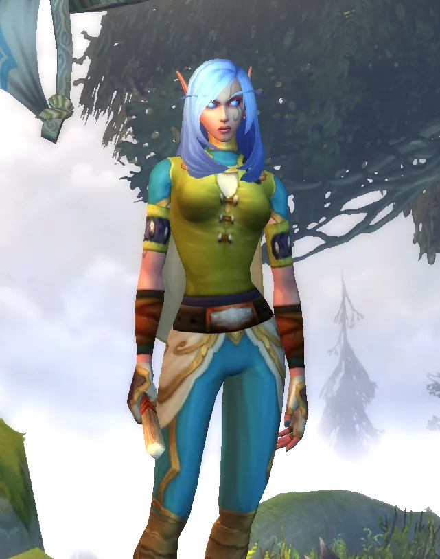

<div align="center">

<a href="#the-mage-who-started-it-all"></a>

# Parzelle's Addon

**The do-everything Mage companion for World of Warcraft: Forever.**

*Named for **Parzelle Starfall**, High Order Skyborne Mage.*

Arcane, Fire or Frost: pick your path and every page follows it. What to cast, what to wear,
where to quest, what to train, where to teleport and everything about the class, in one window
that shows you what to do next.

[](https://github.com/ninepointlabs/parzelles-addon/releases/latest)
[](#requirements)
[](LICENSE)

**[Website](https://parzelles-addon.myazerothlife.com)** ·
**[Install](#install)** ·
**[Features](#features)** ·
**[The mage buttons](#the-mage-buttons)** ·
**[Commands](#slash-commands)** ·
**[FAQ](#faq)**

</div>

<p align="center"></p>

> Screenshots from Parzelle's game at level 8, cropped so no other players' names show.
> More on the **[website](https://parzelles-addon.myazerothlife.com)**.

---

## Contents

- [Install](#install)
- [Getting started](#getting-started)
- [Features](#features)
  - [Home](#home)
  - [The mage buttons](#the-mage-buttons)
  - [Rotation, crowd control and mana](#rotation-crowd-control-and-mana)
  - [Gear: tooltips, bags and where to get it](#gear-tooltips-bags-and-where-to-get-it)
  - [Leveling](#leveling)
  - [Portals and teleports](#portals-and-teleports)
  - [Talents](#talents)
  - [Learn the Mage](#learn-the-mage)
  - [What's new and reminders](#whats-new-and-reminders)
  - [Settings, specs and dual spec](#settings-specs-and-dual-spec)
- [Slash commands](#slash-commands)
- [Where the information comes from](#where-the-information-comes-from)
- [FAQ](#faq)
- [The Mage who started it all](#the-mage-who-started-it-all)
- [For developers](#for-developers)
- [License and credits](#license-and-credits)

---

## Install

Every version is on [GitHub Releases](https://github.com/ninepointlabs/parzelles-addon/releases)
(latest: **v0.1.0**). For World of Warcraft: Forever only.

### Requirements

- **World of Warcraft: Forever** (Interface 16001). Classic Era and retail clients won't load it, by design.
- No other addons needed.

### With OmaForge (Linux)

[OmaForge](https://omaforge.ninepointlabs.com/) installs it and keeps it updated:

```sh
omaforge install -c forever github:ninepointlabs/parzelles-addon
omaforge update -c forever     # later, to pick up new releases
```

### By hand (any OS)

1. Download `ParzellesAddon-<version>.zip` from [GitHub Releases](https://github.com/ninepointlabs/parzelles-addon/releases).
2. Extract it into your Forever AddOns folder, so you end up with:
   ```
   World of Warcraft/_forever_/Interface/AddOns/ParzellesAddon/
   ```
3. Restart the game or type `/reload`.

## Getting started

1. Type **`/parzelle`** (or `/mage`). The first time, you pick **Arcane**, **Fire** or **Frost**.
   Talents start at level 10, so if you haven't decided yet, pick the spec you plan to level as.
2. Start on **Home**: it tells you what to do next.
3. Optional: bind keys to the [mage buttons](#the-mage-buttons) (Conjure, Arcane Intellect) under
   **Settings › Mage buttons › Set key**. No key is bound by default.

You can change spec at any time with the spec pill at the top of the window. With dual spec, talent
spec 1 and 2 each keep their own profile (see [Settings, specs and dual spec](#settings-specs-and-dual-spec)).

---

## Features

The window has a grouped sidebar (Home · *Play:* Rotation, Gear · *Progress:* Leveling, Talents ·
*Learn:* Learn the Mage · What's new, Settings) with a **search box** that finds any spell, talent,
item, quest or dungeon. Every screen has one sub-tab bar and a **Sources & notes** link that shows
where its information comes from.

### Home

What matters right now, every time you open the window:

- **Do next** cards: what your trainer has for you now (or at your next visit), your savings toward
  Apprentice Riding (100g at 40) and Journeyman Riding (1000g at 60) with a progress bar, and your next
  Mage class quest.
- **Needs attention**: missing buffs, conjured food and water running low, upgrades sitting in your
  bags, unread news and new lessons, each with a button that takes you there.
- **Your rotation at a glance**, and the latest changes.

### The mage buttons

Three buttons on one small bar: **Conjure**, **Arcane Intellect** and **Hand out**.

<p align="center">
</p>

#### Conjure

A small button on your screen that shows how much **conjured water, food and mana gem** you have in
your bags. **Each press casts the highest rank you know of whatever you're shortest on**, then the
button moves on to the next thing. Keep pressing until you're stocked up.

**What it makes, in order**

1. **A mana gem**, if you have none.
2. **Water**, until you reach your target.
3. **Food**, until you reach your target.

Targets are yours to set under *Settings › Mage buttons* (by default 20 water, 20 food and 1 gem).
It only uses conjure spells you know, and it shows up once you know one. When you're running low,
Home and a short line after login remind you.

#### Arcane Intellect: buff next

**One press buffs the nearest friendly player who's missing Arcane Intellect:** you first, then your
group (nearest first), your target, then players with friendly nameplates shown (Shift+V). Warriors
and Rogues are skipped, because they have no mana. The name under the button is who's next, with a
"+2" when more people are waiting. Out-of-range and already-buffed players are skipped.

If your spellbook has **Arcane Brilliance**, the button uses it when 3 or more of your party need the
buff (you can turn this off). No WoW Forever source mentions Arcane Brilliance, so it's only used once
you actually have it.

#### Hand out: food and water for your group

- **Left-click** opens a trade with your target (a friendly player), or the next person in your
  group who hasn't had any yet. People low on mana go first. **The trade window fills itself**: by
  default 20 water and 20 food, in the best rank that person can use. **You press Trade.**
- **Right-click** lists your group with everyone's mana. Click a name to trade them. You can also
  tell the group your water's up, or start the list over.
- **Anyone in your group who opens a trade with you** gets the same offer automatically (this can be
  turned off). Players outside your group get nothing unless you press **Add food & water** under the
  trade window.
- Warriors and Rogues get food only. Amounts, auto-offer and the optional chat line ("Water's up!
  Open a trade with me and I'll fill it.") are under *Settings › Mage buttons*. The chat line is off
  by default and only ever sent when you click.

#### Make them yours

The three buttons sit side by side on one small bar. Drag the strip above them to move it
(`/parzelle bar` puts it back). No key is bound by default. Set one for Conjure or Arcane Intellect
under *Settings › Mage buttons › Set key* (or `/parzelle conjure key`, `/parzelle buff key`). Shift,
Ctrl, Alt and extra mouse buttons work; Super/Meta combos are never used.

**Blizzard's rules, kept:** one press, one cast; the addon never casts on its own. The buttons run
their own `/cast` line (no macros in your macro list, no `/click`). What they cast and who they target
only change out of combat. Trading needs your clicks too: the addon opens and fills the trade
window, but the final **Trade** click is always yours.

<sub>There's a [live demo](https://parzelles-addon.myazerothlife.com/#conjure) of the order on the website.</sub>

### Rotation, crowd control and mana

<p align="center"></p>

- Priority lists for **Solo**, **Dungeon** and **Raid**, for each spec, plus **Crowd control** and
  **Mana** sub-tabs.
- **Only spells you can cast at your level.** Spells your level allows but you haven't trained are
  tagged *Train it*. Spells from talents you haven't taken stay hidden until they apply.
- An optional **on-screen helper** shows your next spell large, the two after it, and a row of
  cooldowns.
- **Polymorph tracker** on the helper: who you sheeped and how long it has left, with a warning if it
  breaks early. Frost Nova, Counterspell and Cone of Cold cooldowns sit next to it. If the game hides
  the timer, the helper says so instead of guessing.
- After each fight, chat gets a short **summary** of what you cast, the mana you spent and a tip.
- It only ever advises. Nothing is cast for you.

### Gear: tooltips, bags and where to get it

**Item tooltips** compare any item against what you're wearing in that slot, for your spec:

- **UPGRADE** or **Downgrade**, by roughly how much, against your current item, named.
- **What improves** and **What you'd lose**. School damage counts only for the spec that uses it:
  fire damage for Fire, frost damage for Frost, arcane damage for Arcane. Damage for another school
  is shown but not counted.
- **Equip this** when it's an upgrade of at least 1% that you can wear now; otherwise
  "Upgrade once you reach level N".
- Rings and trinkets are compared against the weaker of your two.

**Bags:** upgrades you can wear now get a glow and an arrow on their slot, and a new one gets a
one-time chat line and pop-up. The glow is drawn separately from Pawn's upgrade arrow, so the two
don't overwrite each other.

**The Gear screen** has five views: *For my level*, *Best overall*, *By bracket*, *Consumables* and
*Weights*. Click an item to see:

- **who drops it** and how often, in which dungeon;
- **which quest rewards it**, its level and faction, and who starts it, with coordinates;
- or **how it's crafted**, with the profession, skill and reagents.

**Mark on map** puts a pin and the guide arrow on the quest giver or the dungeon entrance. Entrance
locations come from the game's own map.

### Leveling

<p align="center"></p>

Sub-tabs: **Path** (your next trainer visits and milestones by level) · **Zones & dungeons** (for your
level and faction) · **Trainer** (every spell rank and the level you learn it) · **Class quests** (your
Mage class quests, ticked off when done) · **Riding & gold** (savings goals, your riding trainer,
vendor and first-mount quest) · **Portals & teleports** (below).

### Portals and teleports

- Every teleport and portal **for your faction only**, with the level you learn it and whether you
  know it.
- **Reagent counts** from your bags. Where the research couldn't confirm that Forever still uses a
  reagent, it's flagged *not confirmed for Forever*.
- A small **travel bar** with one button per teleport or portal you know: **one cast per click**. It's
  filled and opened out of combat.
- A **hearthstone tip**: don't bind your hearthstone to a city you can teleport to; bind it to the inn
  where you're questing.

### Talents

<p align="center"></p>

Recommended builds for your spec, **drawn on Forever's own talent trees**. You see points per talent,
the game's tooltip on hover, and a list of what the build takes. Each build is checked against the
current trees, and one that no longer fits shows its link instead of a wrong picture.

### Learn the Mage

Everything about the class, unlocked as you level:

<p align="center"></p>

| Section | What's in it |
|---|---|
| **Lessons** | Short lessons that unlock by level, plus a hint the first time you learn a spell |
| **Spells** | Every Mage spell: what it does, when to use it, which rank, and how your spec uses it |
| **Talents** | Every talent, with what it does and when to take it |
| **How the class works** | Mana, downranking, crowd control, Forever's new Comprehension tradeskill and more |
| **In a group** | Your job in a dungeon, crowd control, mana breaks |
| **Leveling** | Tips for each spec |
| **Common mistakes** | And how to avoid them |

Anything the sources couldn't confirm is marked as such.

### What's new and reminders

- **What's new** collects Forever and Mage changes, newest first, with an unread count. Addons can't
  go online from inside the game, so new releases carry updated research. An optional
  [companion script](tools/mage-changes-poller/README.md) on your PC can also refresh the list between
  releases from public news feeds.
- **Reminders** for Arcane Intellect, your armor spell, Ice Barrier (Frost), conjured stock, reagents
  and your wand appear on Home and as a small pop-up out of combat. Choose which ones under
  *Settings › Reminders*.

### Settings, specs and dual spec

- **Two profiles per character, A and B**, each with its own spec, gear weights and rotation
  choice. With **dual spec** (learned at level 40), profile A follows talent spec 1 and B follows
  talent spec 2. Swap specs and the addon switches with you. You can also switch by hand from the
  header.
- **Settings** sub-tabs: General · Mage buttons · Tooltips & bags · Reminders · About the data
  (research gaps, conflicts between sources, assumptions, and every source link) · About (version,
  links, credits, and Parzelle Starfall, the Mage it's named for).

---

## Slash commands

| Command | What it does |
|---|---|
| `/parzelle` or `/mage` | Open or close the window |
| `/parzelle spec arcane\|fire\|frost` | Set the spec for the active profile |
| `/parzelle profile A\|B` | Switch profile |
| `/parzelle home` · `rotation` · `gear` · `leveling` · `talents` · `learn` · `news` · `settings` | Open a screen |
| `/parzelle trainer` · `quests` · `riding` · `portals` · `cc` · `mana` · `reminders` · `sources` · `about` | Open a sub-tab directly |
| `/parzelle conjure` | Show or hide the Conjure Button |
| `/parzelle conjure key` | Bind a key to the Conjure Button |
| `/parzelle conjure debug` | Show what the Conjure Button is set to cast and why |
| `/parzelle buff` | Show or hide the Arcane Intellect button (`key` binds it, `debug` explains it) |
| `/parzelle share` | Hand out: trade your target or the next person in your group |
| `/parzelle share menu` | Pick who to hand out to (with everyone's mana) |
| `/parzelle share reset` | Start the hand-out list over |
| `/parzelle share toggle` | Show or hide the Hand out button |
| `/parzelle bar` | Move the mage buttons back to the default spot |
| `/parzelle hud` | Show or hide the on-screen rotation helper |
| `/parzelle reset-hud` | Move the rotation helper back to its default spot |
| `/parzelle remind` | Check your buffs, conjured stock and wand now |

## Where the information comes from

Parzelle's Addon doesn't make things up. Every fact keeps its source and the date it was checked, and
each screen's **Sources & notes** link lists them.

- **Blizzard:** the Mage and Shaman class deep dive, the Forever development and launch notes, and
  Forever's own UI source, used for game behaviour such as dual spec and map pins.
- **Icy Veins:** leveling and PvE guides, class quests, stat priorities, the item and quest database
  (where items drop, quest givers and coordinates) and the Forever talent trees.
- **Wowhead:** spec overviews and gear lists, used only where they match Forever (some of its Mage
  pages still carry content from later expansions, which is left out).

Where sources disagree or say nothing yet, the addon says so instead of guessing. Known gaps include:

- which reagents Forever's teleports and portals still need;
- the names and ranks of Forever's conjured food, water and mana gems (the addon recognises them by
  their tooltip until they're in the research);
- numeric stat weights (the guides publish a priority order only);
- raid best-in-slot before the raids open on December 9.

The full list is under *Settings › About the data*.

## FAQ

<details>
<summary><b>Is it allowed?</b></summary>

Yes. It's advice and information, and it follows Blizzard's addon rules. The only things that ever
cast a spell are your own clicks or key presses on the Conjure, Arcane Intellect and travel bar
buttons, one cast each. The Hand out button opens and fills a trade window, but the final Trade click
is yours. No macros, nothing automatic.
</details>

<details>
<summary><b>Does it work on Classic Era or retail?</b></summary>

No. It's built for World of Warcraft: Forever only, and other clients won't load it. Forever's spells,
talents, quests and gear all differ from Classic.
</details>

<details>
<summary><b>Will it play the game for me?</b></summary>

No. Blizzard doesn't allow that. The rotation helper suggests, the Polymorph tracker watches, and the
Conjure, Arcane Intellect and travel bar buttons cast once per press, and you press Trade yourself.
Everything else is information.
</details>

<details>
<summary><b>Why don't the buttons have keys?</b></summary>

None is bound by default, so it never takes over a key you already use. Pick one under
*Settings › Mage buttons › Set key*. Super/Meta combos are never offered: on many Linux desktops
they belong to the desktop.
</details>

<details>
<summary><b>Can I put the buttons on my action bar?</b></summary>

Not as a macro: Forever's `/click` command won't press addon buttons. Bind it to a key instead.
</details>

<details>
<summary><b>Does it get along with Pawn and other addons?</b></summary>

It has no dependencies. Its bag highlight is drawn separately from Pawn's upgrade arrow, and its
tooltip lines appear alongside other addons' lines.
</details>

<details>
<summary><b>Is this made by Blizzard?</b></summary>

No. Parzelle's Addon is an unofficial, free and open source fan project by
[Nine Point Labs](https://ninepointlabs.com/). It isn't affiliated with or endorsed by Blizzard
Entertainment.
</details>

---

## The Mage who started it all



**Parzelle Starfall** is the Mage this addon is named for: a High Order Skyborne who started out on
Zephras Isle. At level 8 she hadn't picked a spec yet.

Parzelle's Addon is built for her and tested on her, and every screenshot here is from her game.

If you see a Skyborne Mage handing out water and opening portals, say hello.

*May your mana never run dry.*

<br clear="right">

---

## For developers

### Layout

| Path | What's there |
|---|---|
| `ParzellesAddon_Forever.toc`, `ParzellesAddon.toc` | Addon manifests (Interface 16001) |
| `Core/` | Start-up and the Forever-only check (`WOW_PROJECT_ID == 18`), saved settings with the A/B profiles, specs, dual spec, events and slash commands |
| `Modules/` | Logic: stat parsing and gear scoring, tooltips, rotation engine, fight summary, conjured stock, Polymorph tracking, travel, training, quests and gold goals, reminders, lessons, map pins |
| `UI/` | Window, widget kit, rotation helper, Conjure Button, bag highlights, minimap button, and one file per screen in `UI/Panels/` (including the travel bar in `Portals.lua`) |
| `Data/` | **Generated** Lua data. Don't edit by hand |
| `research/` | Source data: `data.json` (facts, each with source and date), `talents_mage.json`, `item_sources.json`, `sources.md`, `NOTES.md` |
| `content/learn.json` | Teaching text and rotation priorities, sourced and flagged ([format](content/README.md)) |
| `tools/` | Data generator, fetchers, dev install script, and the [change poller](tools/mage-changes-poller/README.md) |
| `tests/` | Headless Lua tests with a strict WoW API mock |
| `docs/` | The [website](https://parzelles-addon.myazerothlife.com) (GitHub Pages) |

### Common tasks

```sh
python3 tools/build_data.py            # regenerate Data/*.lua from research/ and content/ (--check to verify)
python3 tools/fetch_talents.py         # refresh Forever's talent trees (Icy Veins calculator data)
python3 tools/fetch_item_sources.py    # refresh where items drop / which quest / how crafted (Icy Veins DB)
lua5.1 tests/run.lua                   # addon tests: every screen and sub-tab, all three specs
python3 tools/mage-changes-poller/tests/test_poller.py
tools/install-dev.sh                   # copy the addon into your Forever AddOns folder
```

The change poller (`tools/mage-changes-poller/poller.py`) is standard-library Python with no logins
or API keys; see its [README](tools/mage-changes-poller/README.md) for a one-off run or an optional
systemd user timer.

CI runs the data check, a Lua syntax check and both test suites on every pull request.

### Releasing

Pushing a `v*` tag runs the [BigWigs packager](https://github.com/BigWigsMods/packager)
(`.github/workflows/release.yml`). It builds `ParzellesAddon-<tag>.zip` and a `release.json` that tells
addon managers like OmaForge the zip is for Forever. Before tagging, check that `## Interface` in both
`.toc` files matches the installed client (`omaforge clients`, or in game
`/run print(GetBuildInfo())`).

## License and credits

- Code: [MIT](LICENSE) © Nine Point Labs.
- Information: Blizzard Entertainment, Icy Veins and Wowhead, credited per fact in the addon.
- Website code: adapted from [OmaForge](https://omaforge.ninepointlabs.com/)'s site (Nine Point Labs, MIT).

World of Warcraft, Warcraft and Blizzard Entertainment are trademarks or registered trademarks of
Blizzard Entertainment, Inc. Game icons © Blizzard Entertainment, Inc. Parzelle's Addon is an
unofficial fan project, not affiliated with or endorsed by Blizzard Entertainment.
